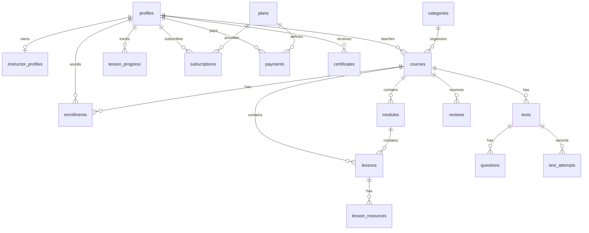

# LearnHub Database Schema

## Entity relationship diagram

## Core tables

- profiles: base user record with role, trial dates, and access metadata.
- instructor_profiles: public instructor profile and verification state.
- courses: product catalog for published and draft content.
- modules: course curriculum grouping.
- lessons: actual learning content and preview/paid flags.
- tests and questions: grading and assessment model.
- enrollments and lesson_progress: learner activity tracking.
- subscriptions and payments: commerce and entitlement records.
- moderation_flags and admin_audit_log: governance and operational review.

## RLS principles

- Users can read and update only their own profile or subscription records.
- Instructors can only modify their own courses and lesson content.
- Students can read their own progress and enrollments.
- Admins can review moderation and audit logs.
- Course catalog reads remain public for published content.
