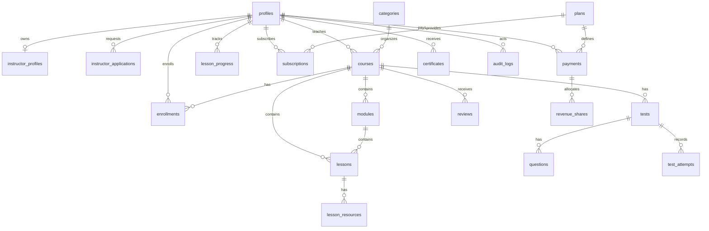

# LearnHub Database Schema

## Entity relationship diagram

## Core tables

- profiles: base user record with role, trial dates, and access metadata.
- instructor_profiles: public instructor profile and verification state.
- courses: product catalog for published and draft content.
- modules: course curriculum grouping.
- lessons: actual learning content and preview/paid flags.
- tests and questions: grading and assessment model.
- enrollments and lesson_progress: learner activity tracking.
- subscriptions and payments: commerce and entitlement records.
- webhook_events: idempotency records for verified Razorpay event IDs.
- revenue_shares: estimated instructor allocation per captured payment, including payout status and reference.
- instructor_applications: instructor onboarding and approval state.
- rate_limits: timestamped failed login/request attempts with `bucket`, `created_at`, and TTL-managed `expires_at`; buckets are SHA-256 digests of scope and identity.
- moderation_flags: reports linked to a course, lesson, or user.
- audit_logs: append-only records of admin mutations (actor_id, action, target_type, target_id, meta, created_at).
- notifications: user-facing approval and moderation updates.

## Status fields

- profiles.status is `active` (or absent for older accounts), `suspended`, or `deleted`. Deleted users are soft-deleted; suspended/deleted users cannot authenticate.
- instructor_applications.status is `pending`, `approved`, or `rejected`.
- instructor_profiles.status is `pending`, `approved`, or `rejected`; `verified_badge` is set by an administrator.
- courses.status includes `draft`, `pending_review`, `published`, `rejected`, `unpublished`, and `archived`.
- categories contain `name`, unique `slug`, `description`, `sort_order`, and `is_active`. Courses reference category documents by `category_id`; categories with associated courses cannot be deleted.

## Indexes

- Unique `profiles.id`, sparse unique `profiles.email`, unique `courses.id`, sparse unique `courses.slug`, and unique `categories.slug`.
- Unique compound indexes on `lesson_progress(user_id, lesson_id)` and `enrollments(user_id, course_id)`.
- Sparse unique `payment_events.event_id`.
- Unique `webhook_events.event_id`; sparse unique `payments.razorpay_order_id` and `payments.razorpay_payment_id`.
- Descending `payments.created_at` index; unique sparse `subscriptions.payment_id` and unique `revenue_shares(payment_id, instructor_id)`.
- Descending `audit_logs.created_at` index for paginated audit history.
- TTL index on `rate_limits.expires_at`; rate limit events expire after their 15-minute window.

`payments.amount_cents` stores paise (not rupees) and payment statuses include `created`, `captured`, `failed`, `refund_pending`, `partially_refunded`, and `refunded`. Subscription records reference the originating payment and include `starts_at`, `ends_at`, and `cancel_at_period_end`. Revenue-share amounts are watch-minute-based estimates, not an automatic bank payout; pending shares for a fully refunded payment are voided. A retained platform share is also recorded for each captured payment.

## RLS principles

- Users can read and update only their own profile or subscription records.
- Instructors can only modify their own courses and lesson content.
- Students can read their own progress and enrollments.
- Admins can review moderation and audit logs.
- Course catalog reads remain public for published content.
